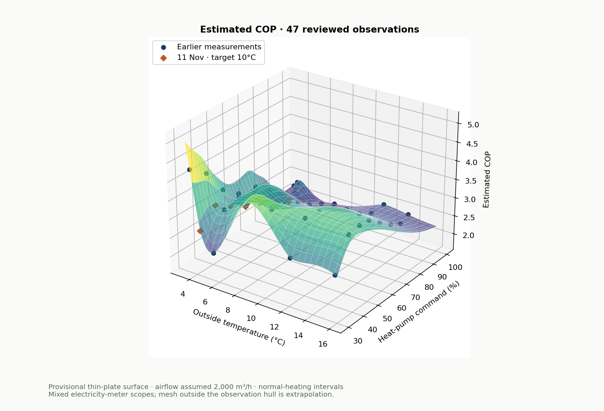
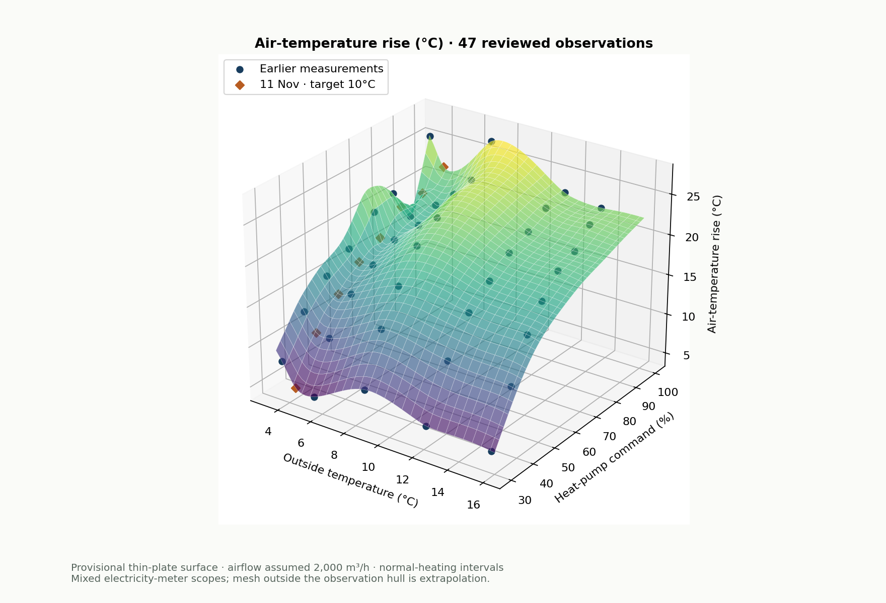
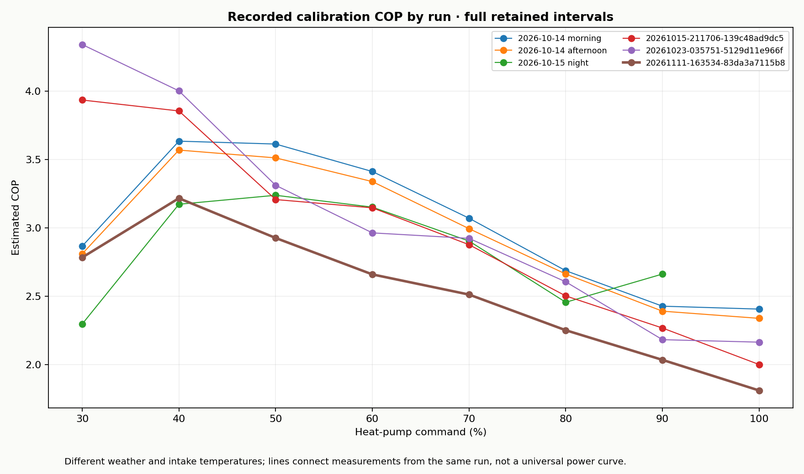

> **Model update 12 November:** Measurements and exclusions below remain unchanged. The v5 fit and numeric examples describe the historical 0.3.64 release. [0.3.65 uses smooth intake-aware v6 and nested run validation](heatpump-cop-surface.md).

# Heat-pump calibration — 11 November 2026

Heating-Control **0.3.64, build 75** adds all eight completed steps from run `20261111-163534-83da3a7115b8`. Recorded 17:35:34–20:03:09 Europe/Berlin. The house was unoccupied, target **10°C**, outside approximately **4.1–4.4°C**, intake approximately **14–15°C**.

The preceding **43 rows remain unchanged**. There are now **51 stored rows**, **47 fitted electrical observations** (24 dedicated-meter and 23 household-counter), six fitted runs, and two thermal-only observations from a seventh run.

## Inclusion and original diagnostics

All eight completed November steps qualify under the owner’s reviewed inclusive policy. Warm-up, modest drift and a low room target do not invalidate a complete matched heat/electricity observation. `originalStable` and `originalUsable` retain the original result. The reviewed `stable`/`usable` flags denote acceptance for the existing model interface; they do not assert that a drifting final window became physically steady. The 90% point therefore remains visibly flagged. Future unrelated measurements retain their existing validation.

Heat and electricity cover identical retained intervals. For the surface, air rise uses the full retained period rather than the final five-minute temperature window. Airflow is assumed **2,000 m³/h**; fan command **90%** is full physical speed. The master-bedroom flap was closed; the other test flaps were open. Dedicated import counter **22365**, power **28681**, export counter **57639**; no household/standby subtraction.

| Power | Outside °C | Intake °C | Outlet °C | Retained s | Excluded s | Input kW | Heat kW (est.) | COP (est.) | Original stable |
| ---: | ---: | ---: | ---: | ---: | ---: | ---: | ---: | ---: | --- |
| 30% | 4.38 | 14.05 | 19.50 | 900 | 0 | 1.312 | 3.652 | 2.784 | Yes |
| 40% | 4.31 | 13.96 | 24.48 | 901 | 0 | 2.193 | 7.052 | 3.216 | Yes |
| 50% | 4.27 | 14.15 | 27.84 | 901 | 0 | 3.135 | 9.172 | 2.926 | Yes |
| 60% | 4.20 | 14.38 | 30.34 | 901 | 0 | 4.021 | 10.696 | 2.660 | Yes |
| 70% | 4.13 | 14.55 | 31.92 | 907 | 686 | 4.633 | 11.641 | 2.512 | Yes |
| 80% | 4.11 | 14.79 | 34.50 | 902 | 0 | 5.864 | 13.206 | 2.252 | Yes |
| 90% | 4.11 | 15.03 | 34.90 | 901 | 0 | 6.542 | 13.314 | 2.035 | No — retained warning |
| 100% | 4.12 | 15.09 | 36.81 | 906 | 751 | 8.030 | 14.546 | 1.812 | Yes |

## Recorded interruptions

These are suspected defrost-like joint temperature collapses, not confirmed equipment defrost signals.

| Step | Excluded bracket · Berlin | Duration | Normal-heating COP | Full-step COP |
| --- | --- | ---: | ---: | ---: |
| 70% | 18:46:44–18:58:10 | 686 s | 2.512 | 2.252 |
| 100% | 19:37:01–19:49:32 | 751 s | 1.812 | 1.622 |

All eight full steps consumed **11.030 kWh**, with **24.040 kWh** estimated net delivered heat: overall estimated COP **2.179**, including interruptions. This is a test-period result, not seasonal efficiency.

## Updated model and charts

Version `provisional-heatpump-surface-2026-11-11-v5` retains the normalized thin-plate/affine **zero-smoothing, equal-weight** method. All 47 observations are reproduced at their centers. The saved reference grid remains **52 × 71 = 3,692 cells**, outside **3.25–16°C**, power **30–100%**; 3,227 cells are inside the observed hull and 465 are marked extrapolation. Whole-run holdout RMSE is **0.582 COP / 2.807°C air rise**, compared with the previous 0.680 / 3.697. This is a validation diagnostic, not a confidence interval.

The 3D chart tab on the protected heating page offers COP, air rise, estimated heat output and electrical input; drag/keyboard rotation, zoom, latest-point highlighting and an exact measurement table. The visible calibration banner remains available in both tabs.







## Module update and reproduction

Update the library from `main`, apply HeatingControl and refresh the protected page. The bundled matrix and surface are updated; matching previously stored November points receive the exact reviewed replacement, including recovery of 90% from the original report. Apply refreshes the stored effective model/JSON and an existing model.json export when no test owns it. Raw JSONL and original summary reports are never rewritten. Custom measured matrices and live control settings remain as configured. A library update does not install itself into running Symcon.

- [Reviewed additions, original comparison fields and source SHA-256 checksums](data/heatpump-calibration-additions-20261111.json).
- [Calibration rows](data/heatpump-calibration.json), [surface observations](data/heatpump-cop-surface-observations.json), [coefficients](data/heatpump-cop-surface.json), [reference grid](data/heatpump-surface-matrix.json).

Reproduce the numeric expansion using the prior files from Heating-Control commit `e554a37dc9d825bd8a6c18e18702846918ce53a4`:

```sh
python libs/tools/expand-heatpump-surface.py PRIOR_CALIBRATION PRIOR_OBSERVATIONS docs/data/heatpump-calibration-additions-20261111.json OUTPUT_DIRECTORY --date 2026-11-11 --version provisional-heatpump-surface-2026-11-11-v5
python libs/tools/plot-heatpump-surface.py --date 2026-11-11
```

The numeric tool verifies historical field preservation, exact fit, SciPy agreement, finite/physical grid outputs and whole-run holdouts. PHP tests cover the grid, inclusion, stored-model recovery and authenticated chart endpoint; browser tests cover both tabs, metrics, rotation and mobile layout.
