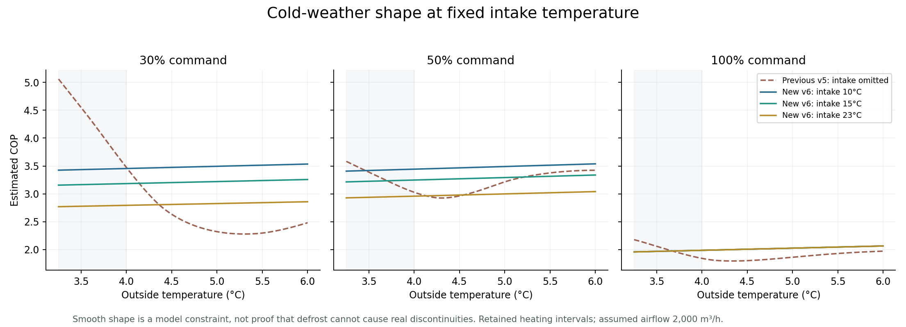
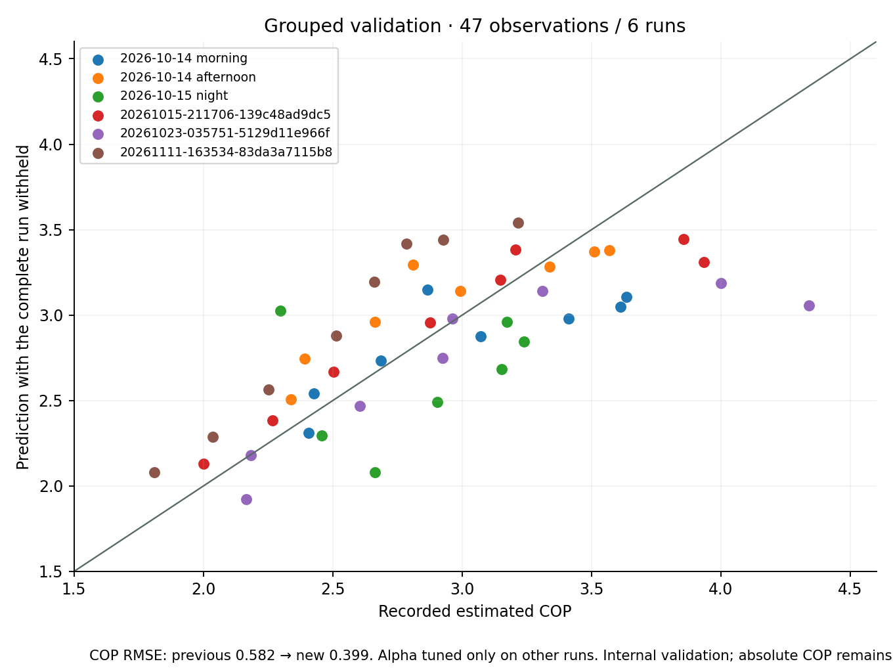
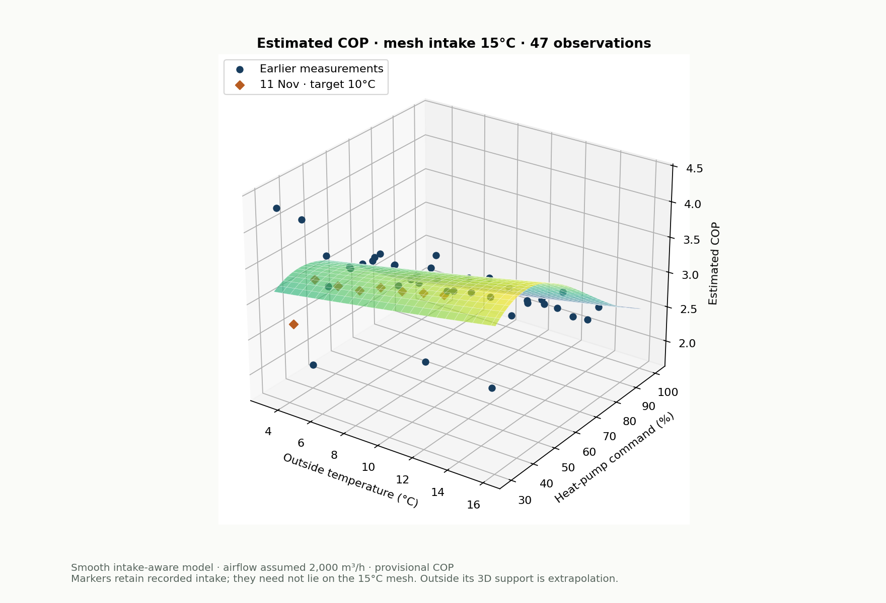

# Intake-aware COP surface — 0.3.65 build 76

The calculated surface now uses **outdoor temperature, requested heat-pump command and actual intake temperature**. A smooth regularised fit replaces exact two-input interpolation. All **51 stored calibration rows**, **47 eligible COP observations across six runs**, original warnings and recorded interruption/recovery exclusions remain unchanged. Two thermal-only observations from another run still provide capacity evidence without invented COP.

This is a reviewed predictive model with better internal validation. **Absolute COP remains provisional** because airflow is assumed, electrical scopes differ and there are only six eligible COP runs. Updating preserves the selected COP method, custom matrix, automatic/manual selection and manual command. The default is still measured-point mode; publication does not install or operate the heat pump.

## Why the old weather dip was unreliable

The 23 October run near 3.6°C outdoors had roughly 9.5–11°C intake; 11 November near 4.2°C had roughly 14–15°C intake. The previous v5 surface omitted intake and exactly fitted every observation. It consequently attributed run, intake, warm-up and meter-scope differences to weather. Those data do not establish a physical efficiency dip around 3–4°C.

The revised weather slices have no reversed weather response at fixed intake. This is an explicit modelling assumption for retained heating intervals, **not proof that real frosting/defrost operation is continuous**. Generic manufacturer curves and clipping measured power to a catalogue rating are not substitutes for observations.



## Reproducible fit

Version `provisional-heatpump-surface-2026-11-12-v6` uses eight basis functions:

```
t = (Tout - 10.5) / 5.5
p = (command - 65) / 35
i = (Tin - 17.5) / 8
basis = [1, t, p, p², p³, i, t*p, p*i]
[COP, electrical kW] = exp(basis * coefficients)
estimated heat kW = COP * electrical kW
air rise °C = heat kW / (0.000335 * 2000)
```

Constrained ridge regression minimises squared log-response residuals with equal observation weights and an unpenalised intercept. The reviewed alpha is **0.3**, selected from `[0.01, 0.1, 0.3, 1, 3, 10]` using complete-run holdouts. Predictions do not pass through every measurement or replace raw calibration rows.

Shape constraints apply over the supported rectangular domain: COP does not decrease with outdoor temperature or increase with intake temperature at fixed other inputs; electrical input and heat output do not decrease with command. Log responses ensure positive predictions. Command-derivative minima are checked analytically at temperature corners, power endpoints and any interior quadratic vertex. These are conservative shape priors, not measured universal laws or a manufacturer-specific performance map.

The runtime domain is **3.25–16°C outdoors, 9.5–25.25°C intake and 30–100% command**, with 1% command candidates. Unsupported inputs follow the existing unavailable-model/gas path. Intake need not match one measurement within a temperature tolerance. Faded cells mark extrapolation beyond the **three-input observation hull**. Extrapolation inside the rectangular domain may still be used under the existing observed-capacity requirement and is identified in the economic snapshot.

Runtime selection passes actual intake to the evaluator. Both modeled rise and existing observed run/power-bracket rise evidence must meet useful-rise and target-plus-supply-margin requirements. The latter is an unmodified observed-capacity guard, **not a second independently validated intake model**. Airflow/flap metadata, price verification, safety margin and hysteresis retain their roles. No generic defrost/cycling penalty is invented.

The [definition](data/heatpump-cop-surface.json), [unchanged observations](data/heatpump-cop-surface-observations.json), [numeric matrix](data/heatpump-surface-matrix.json), [validation predictions](data/heatpump-surface-validation.json) and [archived v5 definition](data/heatpump-cop-surface-v5.json) are bundled. The observation SHA-256 is unchanged from v5.

## Validation

Each outer test removes an entire calibration run. Alpha is chosen using inner complete-run holdouts from the other five runs. The withheld run is then predicted at its measured intake. No held-out values choose that fold's alpha. This is internal model comparison on six existing runs, **not an independent new field trial**.

| Error over all 47 held-out observations | Previous v5 | Intake-aware v6 |
|---|---:|---:|
| COP RMSE | 0.582 | **0.399** |
| Electrical input RMSE | 1.175 kW | **0.613 kW** |
| Air-rise RMSE | 2.807°C | **1.867°C** |
| Maximum absolute COP error | 1.563 | **1.284** |

COP RMSE improves approximately **31%**. Per-run COP RMSE ranges from 0.264 to 0.553. The maximum error and estimated airflow preclude treating a fitted COP as a precise measurement. Run, meter scope, weather and intake remain partly confounded; no separate meter-scope correction or precise causal intake sensitivity is established at every command.



## Independent electrical check

The read-only extraction created `media/heatpump-power-validation/20261112-042139-9d3542` on 12 November at 04:21 Berlin time. Native archive and report hashes are recorded in the [electrical summary](data/heatpump-power-validation-summary-20261112.json).

| Calibration window | Shelly import | Separate pulse meter | Difference |
|---|---:|---:|---:|
| 23 October, 05:45–08:35 Berlin | 9.600 kWh | 9.644 kWh | −0.46% |
| 11 November, 17:20–20:20 Berlin | 11.198 kWh | 11.264 kWh | −0.59% |

All 16 retained October/November model energy totals and durations reproduce from native counter records, including the reviewed October exclusions. November's 100% retained intervals average **8.030 kW Shelly / 8.061 kW pulse meter** over 906 seconds. Its full step averages **7.196 kW**, with 751 seconds excluded from calibration. These are different averaging intervals.

No unit-conversion, active/apparent-power or phase-total error was found. No downward electrical correction is applied. Agreement validates circuit readings under the established 1000-pulse/kWh assumption; it does not prove every watt belongs to the compressor. The exact installed nameplate and circuit coverage still need reconciling with the published 5.95 kW reference. Sparse export-counter boundary records do not establish zero export; signed power integration is separate evidence.

## Chart and reproduction

The protected **3D charts** tab offers mesh intake **10, 15, 20 or 25°C** and COP, air rise, heat output or electrical input. Runtime uses continuous actual intake; chart choices are display slices. Measurement markers/table values retain their own recorded intake, so need not lie on the selected mesh. Original stability warnings, excluded seconds, rotation, zoom, keyboard navigation, passkey protection and the common calibration banner are retained. The chart sends no equipment commands.



Run offline with Python, NumPy, SciPy and Matplotlib:

```
python libs/tools/fit-heatpump-surface.py
python libs/tools/plot-heatpump-surface.py --date 2026-11-12
python libs/tools/plot-heatpump-validation.py
python libs/tools/check-heatpump-power-validation.py EXTRACTION_DIRECTORY \
  --output docs/data/heatpump-power-validation-summary-20261112.json
php tests/heatpump-surface.php
```

The electrical checker needs original `report.json` and `readings.ndjson` files, uses Python's standard library, hashes the raw extraction and checks actual retained model intervals. The older `expand-heatpump-surface.py` remains a historical append/replay utility for v5; use the reviewed fitter for v6.

## Physics references and limits

EnergyPlus' [heating-coil engineering reference](https://bigladdersoftware.com/epx/docs/26-1/engineering-reference/coils.html) treats entering indoor air, outdoor air, flow, speed/part load and defrost as distinct inputs/processes. It supports separating these effects; its coefficients are not imported for this installation. Sinclair's [ASGE-48BI(3) + SCMI-01.4](https://www.sinclair.pl/oferta/agregaty-skraplajace/dc-inverter/asge-48bi3--scmi-014.html) documentation identifies the equipment family, but does not validate custom airflow or meter coverage.

Retained data include warm-up/drift and original stability warnings accepted by the earlier review. The fit preserves them without claiming laboratory steady state. Recorded defrost-like/recovery exclusions remain unchanged. Whole-step/full-cycle energy remains separate evidence; seasonal COP, cycling loss and humidity-dependent defrost corrections require suitable additional measurements.
