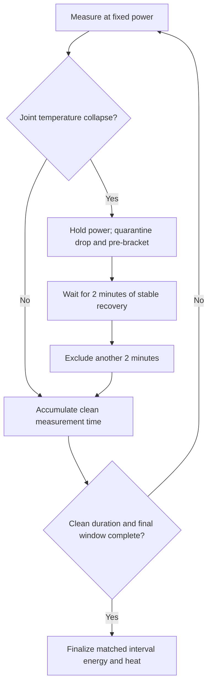

# Retrospective calibration expansion — 23 October 2026

The [reviewed expansion](heatpump-calibration-20261023.md) replays all six archived runs continuously across power boundaries with the criteria below. It identifies four event brackets and adds filtered derivative rows while preserving original measured values. The live test guard described below remains scoped to the current power step; this release expands calibration and runtime source selection, rather than claiming a new live detector. An internal-to-external intake change alone is retained, as are unchanged temperatures and non-event drift.

---

# Calibration through a temperature transient - 0.3.36, build 46

A temporary temperature collapse should not force the entire power step to be
lost. With **HeatPumpTestTransientGuardEnabled** enabled (default for new tests),
the test keeps the same heat-pump power and test airflow commands, records the
interruption, excludes a bounded time window and extends measurement at that
same power after recovery. Other test and equipment protections retain priority.
This is a suspected temperature pattern, not a confirmed defrost-status signal.

## Detection and recovery

The detector compares current readings with a recent healthy reference from the
current power step. It requires all of:

- At least 8°C and 40% reduction in outlet-minus-inlet rise.
- At least 6°C reduction in the outlet temperature itself.
- At least 8°C reduction in exchanger temperature.
- The reference had at least 5°C air rise and 10°C exchanger-minus-inlet lift.

The reference comes from the upper part of the previous five minutes of air-rise
readings, excluding the newest 30 seconds. At least six readings over 50 seconds
are required. An immediate relapse can reuse the previous event's reference for
up to five minutes after release. A change in intake temperature alone cannot
trigger a window. Ordinary modulation below the joint drop thresholds is retained.

The exclusion begins **60 seconds before the last healthy reference**, clamped
to this step's start. After the drop, recovery requires air rise at least 80% of
its reference (and at least 5°C), exchanger-minus-inlet lift at least 60% of its
reference (and at least 5°C), and **120 seconds** of stable readings. During that
hold, air-rise range must not exceed 2°C and exchanger range must not exceed 3°C.
Then a further **120-second post-recovery bracket** is excluded. A new collapse
or excessive drift resets recovery. Overlapping windows form one union and are
never subtracted twice.

The step advances only after it has the requested number of retained seconds
and a continuous final stability window after the exclusion. The existing
stricter final steady-window stability tests still determine whether a completed
point is usable. The detector does not promote an unsettled point automatically.

## Matched energy accounting and reporting

`stepStartedAt` / `stepEndedAt` remain the wall-clock bounds. A point additionally
records `measurementIntervals`, `measurementSeconds`, `excludedIntervals`,
`excludedSeconds` and `measurementBasis`.

Main temperature means and heat estimates are weighted by the retained interval
durations. Electrical energy is the sum of counter differences over **exactly
those same intervals**, including independently validated counter boundaries at
each internal start/end. Dedicated mode never subtracts household or standby
energy. Legacy house mode subtracts its validated pre-test baseline for retained
seconds only. Counter resets, exports, missing boundaries and meter faults are
never excused by a thermal exclusion.

`fullStep` separately preserves the unfiltered step's temperatures, wall time,
electricity, estimated heat and COP, including all quarantined periods. It uses
the same estimated fixed-airflow basis; it is not a certified seasonal COP or a
measurement of actual airflow. Use this inclusive result when inspecting the
cost of an interruption; the filtered calibration COP represents normal heating.
Existing raw records are never edited. Event start, recovery and window closure
are appended to JSONL and included in the result. The protected page shows both
COP values and the excluded duration. Event/counter records remain downloadable.

The saved surface is not automatically refitted, and past excluded 80%/90%
measurements are not retroactively relabelled. A replay fixture verifies that
the latest run triggers only at its recorded 90% collapse; its original step
ended too early to satisfy the new stable-recovery hold, so a live test would
continue that same power instead of inventing missing post-recovery data.

## Bounds and existing controls

- Unrecovered event: stop the test after **20 minutes**. A recovered event may
  finish its post bracket. A subsequent relapse remains subject to the original
  event's recovery deadline.
- At most **three events per power step** and **30 minutes of extension per
  step**, including recovery brackets and any required final-window collection.
- Manual cancel, temperature limits, meter failures, explicit shutdown,
  configuration changes and unexpected timer/restart gaps still stop the test.
- The scheduled Symcon reboot guard includes remaining clean measurement time
  and pending recovery in its calculation. It stops safely, preserves the
  interrupted-transient audit and repeats a fresh step after reboot. Retained
  samples are never joined across a reboot.
- The enable setting is snapshotted at test start. Changing configuration during
  an active test retains the existing cancel-on-change behavior. Old saved test
  states without this setting do not silently enable filtering.

## Normal-operation cold-air protection

This release changes calibration, not normal heating. Normal heating already
checks exchanger-minus-inlet before running the fan; tests intentionally command
a fixed fan. A stronger proposed operating guard would stop cold-air delivery,
allow internal defrost, require a warmed exchanger before restarting airflow,
verify supply temperature after restart and use a bounded controlled gas fallback.
That proposed normal-operation state machine is not installed by this release.

